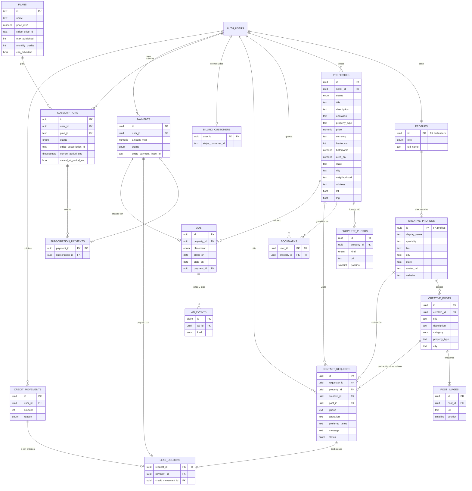

# Modelo de datos

La base está en **3FN** (todas las tablas): cada columna guarda un solo dato, depende solo de la llave de su tabla y no se copia nada que se pueda sacar de otra tabla.
Esto reemplaza el patrón "columna relacional + cuerpo JSONB" del SRS: desde la migración `0008` el detalle de la propiedad vive en columnas normales y las fotos en su propia tabla.

Las apps siguen trabajando con la forma de `PropertyData` de Zod (`packages/schemas`): `toProperty()` arma ese objeto a partir de las columnas y `save_property()` lo guarda.

## Diagrama entidad-relación

Todas las tablas tienen `created_at`; las que se editan tienen además `updated_at`.

## Tablas

| Tabla | Qué guarda | Llave |
|---|---|---|
| `profiles` | Rol y nombre de cada cuenta | `id` = usuario |
| `properties` | Propiedades: datos, precio y ubicación en columnas | `id` |
| `property_photos` | Una fila por foto (`kind = foto`, la posición 0 es la portada) y la 360 (`kind = panorama`, una por propiedad) | `id`; único (`property_id`, `kind`, `position`) |
| `creative_profiles` | Perfil público del creativo | `id` = perfil |
| `creative_posts` | Publicaciones del portafolio | `id` |
| `post_images` | 1 a 10 imágenes por publicación, en orden | `id`; único (`post_id`, `position`) |
| `bookmarks` | Mi Lista: usuario ↔ propiedad | (`user_id`, `property_id`) |
| `contact_requests` | Solicitud de un cliente. Va a **una sola** cosa: `property_id` (visita), `creative_id` (cotización desde el perfil) o `post_id` (cotización sobre una publicación) | `id` |
| `plans` | Freemium, Pro, Enterprise: precio y límites (provisionales, los confirma el PO) | `id` |
| `billing_customers` | Cliente de Stripe de cada usuario | `user_id` |
| `subscriptions` | Suscripción de Stripe; solo una viva por usuario | `id` |
| `payments` | Cada cobro de Stripe | `id` |
| `subscription_payments` | Qué cobros son de qué suscripción | `payment_id` |
| `credit_movements` | Créditos que entran (+) o salen (−). El saldo es la suma | `id` |
| `lead_unlocks` | Solicitudes desbloqueadas, con un pago **o** con créditos, una sola vez | `request_id` |
| `ads` | Anuncios pagados de una propiedad en el buscador o el muro | `id` |
| `ad_events` | Cada vista o clic de un anuncio | `id` |

## Datos que se calculan (no se guardan)

Guardarlos rompería la 3FN, así que se calculan en la base:

| Dato | Cómo se obtiene |
|---|---|
| Tipo de solicitud (`visita` / `cotizacion`) | Función `kind(contact_requests)`. Las apps lo piden con `select("*, kind")` |
| Quién recibe una solicitud | `request_recipient()`: el vendedor de la propiedad, el creativo o el dueño de la publicación |
| Nombre y correo del cliente para quien recibe | `my_inbox()`: la bandeja de la Consola, con los datos actuales del cliente |
| Plan actual | `my_plan()`: la suscripción activa o `freemium` |
| Saldo de créditos | `my_credits()`: suma de `credit_movements` |
| Anuncio vigente | `ad_is_live()`: hoy (hora de México) dentro de las fechas pagadas, con el pago en `pagado` y la propiedad publicada |
| Vistas y clics de un anuncio | `my_ad_stats()`: los anuncios del vendedor con `count(*)` sobre `ad_events` |

## Validación en dos niveles

1. **Zod (apps):** revisa el formulario antes de guardar y muestra mensajes claros.
2. **Base de datos:** `check` en cada columna (título 3–120, precio > 0, tipo y operación válidos, estado y ciudad, URLs `https://`, de 1 a 10 imágenes, hasta 30 fotos). Nada entra roto aunque alguien se salte la app.

`save_property()` y `save_post()` guardan la fila y sus fotos o imágenes en una sola transacción: si algo falla, no se guarda nada.

## Formas normales

| Forma | Cómo se cumple |
|---|---|
| 1FN | No hay JSON ni listas: las fotos y las imágenes son filas en su propia tabla |
| 2FN | Las tablas con llave compuesta (`bookmarks`) no tienen columnas que dependan de una parte de la llave |
| 3FN | Nada se copia: el tipo, el destinatario y los datos del cliente de una solicitud, el plan actual y el saldo se calculan. Una cotización sobre una publicación guarda solo `post_id` (el creativo sale de la publicación) |
