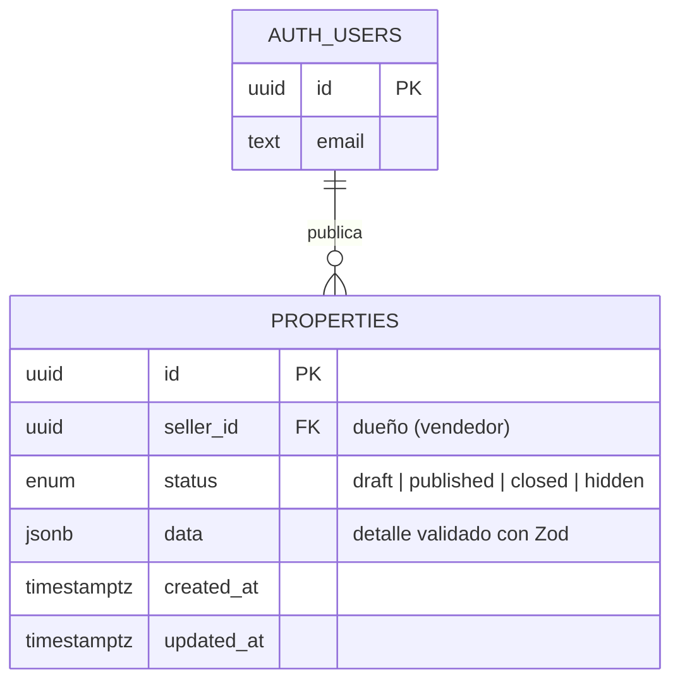

# Modelo de datos de propiedades (ZAI-19 · DATA-01)

El SRS pide el patrón **"columna vertebral relacional + cuerpo flexible JSONB"**:

- Lo que **siempre** tiene una propiedad y sirve para seguridad y orden va en **columnas fijas** (SQL).
- El **detalle** de la propiedad (título, precio, recámaras, ubicación, fotos) va en una sola columna **`data` (JSONB)**, porque puede crecer sin cambiar la tabla.
- La forma de `data` se valida con **Zod** en `packages/schemas/src/property.ts`, y lo usan todas las apps.

## Diagrama

## Columnas fijas

| Columna | Tipo | Para qué |
|---|---|---|
| `id` | uuid | Identificador de la propiedad |
| `seller_id` | uuid → `auth.users` | Quién la publicó. Lo usan los permisos (RLS) en ZAI-20 |
| `status` | enum | `draft`, `published`, `closed` o `hidden` (RF-VEN-01). Solo `published` se ve en el Escaparate |
| `data` | jsonb | Detalle de la propiedad (abajo) |
| `created_at` / `updated_at` | timestamptz | Fechas de creación y último cambio (se actualiza sola) |

## Contenido de `data`

| Campo | Tipo | Obligatorio | Ejemplo |
|---|---|---|---|
| `title` | texto (3–120) | Sí | "Casa con jardín en Zapopan" |
| `description` | texto (hasta 2000) | No | |
| `operation` | `venta` / `renta` | Sí | `venta` |
| `propertyType` | `casa`, `departamento`, `terreno`, `local`, `oficina` | Sí | `casa` |
| `price` | número > 0 | Sí | 3850000 |
| `currency` | `MXN` / `USD` | No (MXN) | `MXN` |
| `bedrooms` / `bathrooms` | número ≥ 0 | No (0) | 3 / 2.5 |
| `areaM2` | número > 0 | No | 210 |
| `location` | `state`, `city`, `neighborhood`, `address`, `lat`, `lng` | Estado y ciudad | Jalisco, Zapopan |
| `media` | `coverUrl`, `gallery[]`, `panorama360Url` (URLs de Cloudinary) | No | |

## Validación en dos niveles

1. **Zod (apps):** revisa todo el formulario antes de guardar y muestra mensajes claros.
2. **Base de datos (respaldo):** revisa lo mínimo para que nunca entre un dato roto, aunque alguien se salte la app: que haya título, precio positivo, un tipo válido y ciudad.

## Cómo aplicarlo en Supabase

1. **SQL Editor → New query** → pegar `supabase/migrations/0001_properties.sql` → **Run**.
2. **Authentication → Users → Add user**: crear un usuario de prueba.
3. Pegar `supabase/seed/0001_properties_demo.sql` → **Run**. Deben aparecer **3 propiedades**.
4. Pegar `supabase/seed/0002_prueba_rechazo.sql` → **Run**. **Debe fallar** con `properties_data_has_price`: eso demuestra que la validación funciona.

> RLS ya queda **activado** en la tabla. Las reglas de quién puede ver o editar cada propiedad se agregan en **ZAI-20 (RNF-SEC-01)**.
