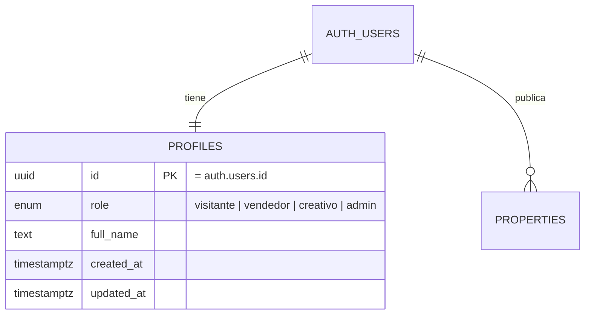

# Registro, inicio de sesión y permisos (ZAI-20 · RNF-SEC-01)

> "Como vendedor o creativo quiero crear mi cuenta e iniciar sesión para administrar solo mi propia información."

- **Registro e inicio de sesión:** Supabase Auth con correo y contraseña.
- **Roles:** cada usuario tiene una fila en `profiles` con su rol: `visitante`, `vendedor`, `creativo` o `admin`.
- **Permisos:** las reglas viven en la base de datos (RLS), así que se cumplen aunque alguien se salte la app.

## Diagrama



## Cómo se crea el perfil

1. La app llama a `supabase.auth.signUp()` y manda el rol y el nombre en `options.data`:
   ```ts
   await supabase.auth.signUp({
     email, password,
     options: { data: { role: "vendedor", full_name: "Ana López" } },
   });
   ```
2. Un trigger (`handle_new_user`) crea la fila en `profiles`.
3. Solo se aceptan `visitante`, `vendedor` o `creativo`. **Nadie puede registrarse como admin**: si lo pide, queda como visitante. El admin se asigna a mano desde el SQL Editor.
4. El usuario puede cambiar su nombre, pero **no su rol**.

La validación del formulario está en `packages/schemas/src/profile.ts` (`SignUpSchema`, `SignInSchema`).

## Quién puede hacer qué

| | Ver publicadas | Ver borradores, cerradas y ocultas | Crear | Editar / borrar |
|---|---|---|---|---|
| Visitante sin sesión | Sí | No | No | No |
| Visitante o creativo con sesión | Sí | No | No | No |
| Vendedor | Sí | Solo las suyas | Solo a su nombre | Solo las suyas |
| Admin | Sí | Todas | Sí | Todas |

Un vendedor tampoco puede "pasarle" su propiedad a otro cambiando `seller_id`.
Los perfiles son privados: cada quien ve solo el suyo. El perfil público del creativo llega en ZAI-27.

## Cómo aplicarlo en Supabase

1. **SQL Editor → New query** → pegar `supabase/migrations/0002_profiles_y_permisos.sql` → **Run**.
   Al usuario `vendedor.demo@zaisanfy.test` se le crea su perfil como **vendedor** porque ya tiene propiedades.
2. Pegar `supabase/tests/0002_prueba_permisos.sql` → **Run**. Debe terminar con **`ZAI-20 OK`**.
   La prueba crea 2 vendedores y un visitante, se hace pasar por cada uno y al final deshace todo (no deja datos).
   Si algo falla, sale un error que empieza con `FALLA:` y dice qué regla no se cumplió.
3. Para probar el registro desde la app: **Authentication → Sign In / Providers → Email** debe estar activo. Mientras se prueba se puede apagar **Confirm email** para no esperar el correo.
