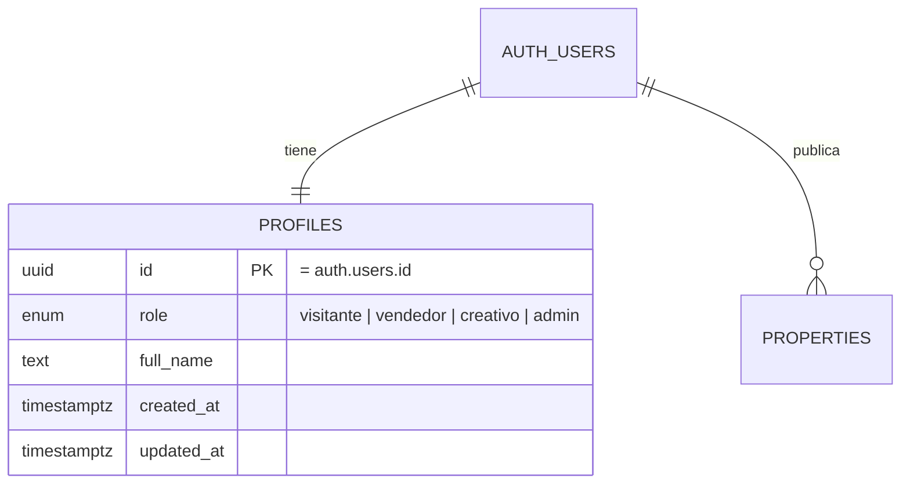

# Registro, inicio de sesión y permisos (ZAI-20 · RNF-SEC-01)

> "Como vendedor o creativo quiero crear mi cuenta e iniciar sesión para administrar solo mi propia información."

- **Registro e inicio de sesión:** Supabase Auth con correo y contraseña.
- **Roles:** cada usuario tiene una fila en `profiles` con su rol: `visitante`, `vendedor`, `creativo` o `admin`.
- **Permisos:** las reglas viven en la base de datos (RLS), así que se cumplen aunque alguien se salte la app.

## Diagrama



## Cómo se crea el perfil

1. La app llama a `supabase.auth.signUp()` y manda el rol y el nombre en `options.data`:
   ```ts
   await supabase.auth.signUp({
     email, password,
     options: { data: { role: "vendedor", full_name: "Ana López" } },
   });
   ```
2. Un trigger (`handle_new_user`) crea la fila en `profiles`.
3. Solo se aceptan `visitante`, `vendedor` o `creativo`. **Nadie puede registrarse como admin**: si lo pide, queda como visitante. El admin se asigna a mano desde el SQL Editor.
4. El usuario puede cambiar su nombre, pero **no editar su rol directamente**.
5. **Mejora de cuenta** (0007): un `visitante` puede volverse `vendedor` o `creativo` con el RPC `upgrade_role(new_role)`.
   Nunca admin, nunca bajar de rol ni cambiar entre vendedor y creativo (eso lo hace un admin). Prueba: `supabase/tests/0007_prueba_mejora_de_cuenta.sql` → `MEJORA DE CUENTA OK`.

El registro es uno solo en el Escaparate (`/entrar`), con 3 tipos de cuenta: Busco casa (visitante), Vendo o rento (vendedor) y Ofrezco servicios creativos (creativo). La Consola también permite registrar socios.

La validación del formulario está en `packages/schemas/src/profile.ts` (`SignUpSchema`, `SignInSchema`).

## Quién puede hacer qué

| | Ver publicadas | Ver borradores, cerradas y ocultas | Crear | Editar / borrar |
|---|---|---|---|---|
| Visitante sin sesión | Sí | No | No | No |
| Visitante o creativo con sesión | Sí | No | No | No |
| Vendedor | Sí | Solo las suyas | Solo a su nombre | Solo las suyas |
| Admin | Sí | Todas | Sí | Todas |

Un vendedor tampoco puede "pasarle" su propiedad a otro cambiando `seller_id`.
Los perfiles son privados: cada quien ve solo el suyo. El perfil público del creativo llega en ZAI-27.

## Qué pide cuenta y qué pide verificación

Regla: **libre para mirar, cuenta para interactuar, cuenta verificada para publicar o pagar.**
Mirar sin cuenta no tiene riesgo (nadie puede escribir ni cambiar nada) y deja las páginas visibles para Google (ZAI-25).

| Nivel | Acciones | Estado |
|---|---|---|
| Sin cuenta | Ver propiedades, visor 360, muro y perfiles de creativos | Hecho |
| Cuenta (correo confirmado) | Mi Lista; contacto y cotización (F3 · ZAI-33); reportar | Mi Lista hecho (ZAI-31); lo demás en F3 |
| Cuenta verificada | Publicar como vendedor o creativo; pagos y premium (F3 · ZAI-32/34) | Hoy basta la cuenta; la verificación llega en F3 |

Todos se registran en el **Escaparate** (`/entrar`) eligiendo su tipo de cuenta; la **Consola** solo la usan vendedores y creativos.

### Candados contra trolls y abuso

1. **Confirmación por correo obligatoria**: **Confirm email** encendido en producción.
2. **Captcha Cloudflare Turnstile en el registro** (Authentication → Attack Protection).
3. **Límite de solicitudes de contacto por día** por usuario, aplicado en la base de datos.
4. **Verificación extra para vendedores premium** (teléfono y, si se decide, revisión manual) antes de publicar.
5. **Pagos solo con Stripe.** Zaisanfy nunca guarda tarjetas. El premium **solo lo cambia el servidor** (webhook de Stripe); el usuario no puede editar ese campo (RLS).
6. **Botón "Reportar"** en propiedades y publicaciones; el admin las pasa al estado **oculta** (`hidden`, ya existe).

## Cómo aplicarlo en Supabase

1. **SQL Editor → New query** → pegar `supabase/migrations/0002_profiles_y_permisos.sql` → **Run**.
   Al usuario `vendedor.demo@zaisanfy.test` se le crea su perfil como **vendedor** porque ya tiene propiedades.
2. Pegar `supabase/tests/0002_prueba_permisos.sql` → **Run**. Debe terminar con **`ZAI-20 OK`**.
   La prueba crea 2 vendedores y un visitante, se hace pasar por cada uno y al final deshace todo (no deja datos).
   Si algo falla, sale un error que empieza con `FALLA:` y dice qué regla no se cumplió.
3. Para probar el registro desde la app: **Authentication → Sign In / Providers → Email** debe estar activo. Mientras se prueba se puede apagar **Confirm email** para no esperar el correo.
